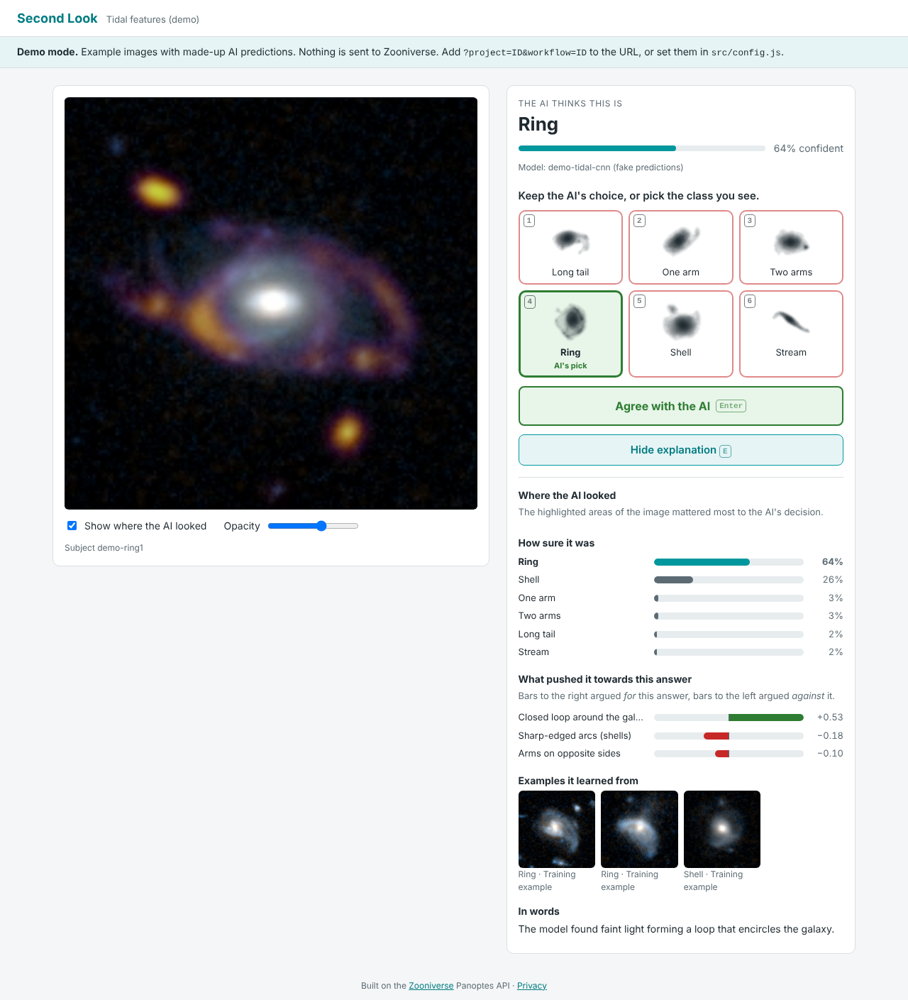

# Second Look

A Zooniverse custom front end where volunteers review an AI's classification
instead of starting from scratch. Every class is shown as a clickable
silhouette, and the AI's pick is already selected. For each subject the
volunteer can:

- **Accept** the AI's answer by submitting its preselected class (outlined green),
- **Reject** it by picking a different class (outlined red) and submitting that, or
- ask **"Why does the AI think this?"** to see an explanation first.



The explanation is built for a classic image classifier and revealed step by
step, so each thing a volunteer chooses to look at is recorded:

| Part | What the volunteer sees |
|---|---|
| Saliency map | A heatmap over the image showing where the model looked, with a toggle and an opacity slider. Shown when the explanation is opened. |
| Class confidence | The model's confidence in every class, the AI's pick marked. Shown when the explanation is opened. |
| Nearest training examples | Hidden until the volunteer clicks a class. For the AI's class: *"Why Ring?"*, the training galaxies most like this one that were labelled Ring (factual). For any other class: *"Why not Shell?"*, the most similar Shells (a case-based counterfactual). One class is open at a time. |

Each decision is sent to Panoptes as an ordinary classification. Metadata
records whether the volunteer opened the explanation, how long they kept it
open, and how long they took to decide, so you can study how explanations
change agreement with the AI.

Volunteers also answer short questionnaires. A few questions on attitudes to
AI come on their first visit, and a three-item check-in on autonomy,
competence and relatedness comes after every fifth classification. See [Questionnaires](#questionnaires).

Like [cosmic-canvas](https://github.com/astrohayley/cosmic-canvas), it has no
build step: static HTML, CSS and ES modules that you can host on GitHub Pages.

## Try it

```bash
npm start            # or: python3 -m http.server 8080
```

Open <http://localhost:8080/>. With no project configured it runs in **demo
mode** with 22 example galaxies in six tidal-feature classes (long tail, one
arm, two arms, ring, shell, stream). The AI predictions and attention maps are
made up, and 5 of the 22 are deliberately wrong. Nothing is sent to Zooniverse, and the payload that
would have been sent appears under "Last classification payload".

Keyboard: <kbd>1</kbd>–<kbd>6</kbd> pick a class · <kbd>Enter</kbd> submit · <kbd>E</kbd> show/hide the explanation.

## Connecting it to a Zooniverse project

### 1. Create the workflow

In the [Project Builder](https://www.zooniverse.org/lab), create a workflow
with one **Question** task (key `T0`, single answer) with one answer per class,
in the same order as `CONFIG.classes` in [`src/config.js`](src/config.js).

The annotation value is the index of the class the volunteer submitted, so the
standard Zooniverse export reads like any classification workflow. Whether
that was an accept or a reject is recorded in the metadata (see
[What gets recorded](#what-gets-recorded)). If you use a different task key,
change `CONFIG.task`. The page shows a warning if the workflow doesn't have the
expected task or the number of answers doesn't match the classes.

### 2. Upload subjects with AI output in their metadata

The model output travels in **subject metadata**, so all you need is a subject
set. [`scripts/upload_subjects.py`](scripts/upload_subjects.py) uses the
[panoptes-python-client](https://github.com/zooniverse/panoptes-python-client)
to upload a CSV of predictions:

```bash
pip install -r scripts/requirements.txt
python3 scripts/upload_subjects.py scripts/example_predictions.csv --dry-run   # validate only
python3 scripts/upload_subjects.py predictions.csv --project 12345 --workflow 67890 --set-name "Model v1"
```

See [`scripts/example_predictions.csv`](scripts/example_predictions.csv) for the
format. If you upload subjects another way, use these metadata keys. Values are
strings, and structured values are JSON strings. Only `#ai_label` is required.
Subjects without it are skipped.

| Key | Example | Notes |
|---|---|---|
| `#ai_label` | `spiral` | The model's predicted class |
| `#ai_confidence` | `0.91`, `91`, `91%` | Falls back to the label's entry in `#ai_probabilities` |
| `#ai_probabilities` | `{"spiral":0.91,"elliptical":0.09}` | Object or `[{"label","value"}]` list |
| `#ai_saliency` | `1` or `https://…/heat.png` | Index into the subject's `locations`, or a URL. A transparent PNG the same size as the image works best |
| `#ai_examples` | `[{"url":"…","label":"ring"},{"url":"…","label":"shell"}]` | For each class, the training galaxies nearest this subject in the model's feature space (a few per class). A class without examples can't be drilled into. Untagged examples count as the AI's class |
| `#ai_model` | `galaxy-cnn-v2` | Shown under the confidence bar and stored with each classification |

The `#` prefix hides these fields from volunteers in the standard Zooniverse
metadata viewer. Change the keys in `CONFIG.metadataKeys` if needed.

List the model's classes in `CONFIG.classes`, keyed by the raw label in
`#ai_label`, with a display name and a silhouette. Subjects whose AI label is
not one of these classes are skipped. A silhouette can be any single-colour SVG
or transparent PNG; the page tints it to match the theme. The silhouettes in
`assets/classes/` were made by masking out one clear example of each class,
in the style of the Tidal Tales icons. `scripts/silhouette.py` does the
masking; choose the source images in `SILHOUETTE_FROM` in
`scripts/make_demo_subjects.py`.

### 3. Point the page at the project

Set `projectId` and `workflowId` in [`src/config.js`](src/config.js), or use
URL parameters:

| Parameter | Effect |
|---|---|
| `?project=12345` | Project ID (without one, the page runs in demo mode) |
| `?workflow=67890` | Workflow ID (default: the project's first active workflow) |
| `?env=staging` | Use the Panoptes staging API |
| `?xai=on-request` \| `always` \| `never` | How explanations are offered (see below) |
| `?demo` | Force demo mode |
| `?debug` | Show the classification payload in live mode too |
| `?surveys=off` | Skip both questionnaires for this visit |
| `?reset` | Forget this browser's participant ID, answers and classification count |

### 4. (Optional) Let volunteers sign in

Without sign-in, classifications are anonymous. To credit volunteers, register
an OAuth application on Panoptes and add this page's exact URL as its redirect
URI. Then put the client ID in `CONFIG.oauthClientId`. The page uses the
implicit grant, which works from a static site without a client secret.

### 5. Deploy

Push to GitHub and enable **Settings → Pages → Deploy from a branch** (root of
the branch). `.nojekyll` is already in place.

## What gets recorded

```jsonc
{
  "annotations": [{ "task": "T0", "value": 3 }],      // index of the submitted class
  "metadata": {
    "workflow_version": "7.2", "started_at": "…", "finished_at": "…",
    "user_agent": "…", "user_language": "en-GB", "utc_offset": "0",
    "viewport": { "width": 1280, "height": 900 },
    "source": "second-look",
    "ai_review": {
      "decision": "reject",                   // "accept" if the AI's class was submitted
      "chosen_label": "ring",
      "ai_label": "shell", "ai_confidence": 0.58, "ai_model": "tidal-cnn-v1",
      "explanation_mode": "on-request",
      "explanation_available": true,
      "explanation_parts": ["saliency", "probabilities", "examples"],
      "explanation_viewed": true,
      "decision_path": "after_explanation",   // or "direct"
      "time_to_decision_ms": 8421,
      "time_to_explanation_ms": 2210,         // null if never opened
      "explanation_dwell_ms": 5873,           // total time the explanation was open
      "selection_changes": 1,                 // times the volunteer picked a class
      "examples_viewed": ["shell", "ring"],   // classes drilled into, in order
      "counterfactual_viewed": true,          // opened any class other than the AI's
      "events": [                              // up to 100 interactions
        { "type": "explanation_open", "t_ms": 2210 },
        { "type": "examples_open", "t_ms": 5120, "detail": { "label": "shell", "kind": "counterfactual" } },
        { "type": "examples_close", "t_ms": 7310, "detail": { "label": "shell" } },
        { "type": "select", "t_ms": 7950, "detail": "ring" },
        { "type": "heatmap_opacity", "t_ms": 4012, "detail": 0.85 }
      ]
    },
    "participant": {                          // on every classification
      "id": "3f1c…",                          // anonymous, stored in this browser
      "classification_number": 5,             // this volunteer's nth classification
      "skepticism": { "survey": "ai_skepticism", "responses": { … }, "scores": { "skepticism": 4.5 }, … }
    },
    "needs": {                                // only on every 5th classification
      "survey": "needs", "version": "1", "block": 1,
      "responses": { "autonomy": 6, "competence": 5, "relatedness": 2 },
      "scores": { "autonomy": 6, "competence": 5, "relatedness": 2 },
      "started_at": "…", "completed_at": "…", "duration_ms": 9234
    }
  },
  "links": { "project": "123", "workflow": "456", "subjects": ["901"] },
  "completed": true
}
```

The AI's label and confidence are copied into each classification. If you
re-upload subjects with a newer model, each classification still shows which
prediction the volunteer was judging.

## Questionnaires

Both questionnaires use 7-point scales and must be fully answered before the
volunteer can continue. They are defined in [`src/surveys.js`](src/surveys.js),
and `CONFIG.surveys` turns them on or off.

**AI skepticism (first visit).** Six items on attitudes to AI in general:
three distrust items and three reverse-keyed trust items. The score is the
mean, and a higher score means more skeptical. The items are adapted from the
Trust in Automated Systems scale (Jian, Bisantz & Drury, 2000) and reworded to
refer to AI rather than a specific system. Replace them with another instrument
if your study calls for one.

**Needs check-in (every 5th classification).** One item each for autonomy,
competence and relatedness, adapted from the single-item basic psychological
needs measures. The items are reworded in the past tense to refer to the
classifications the volunteer has just done, following the Zooniverse
adaptation of the BPNSFS items. Each item is scored on its own, from
1 (very strongly disagree) to 7 (very strongly agree). The check-in opens after
the volunteer decides on their 5th, 10th, 15th… subject. The answers go in
that classification, so they reach Panoptes together.
`CONFIG.surveys.checkInEvery` changes the interval.

**Where the answers go.** A static page can only send data to Zooniverse as
classifications, so answers travel in classification metadata (see above).
Each browser gets a random participant ID that links a volunteer's
classifications and answers. The ID is stored in `localStorage` with their
skepticism answers and classification count. The count carries over between
visits, so the check-in stays on schedule. Clearing site data or switching
browsers starts a new participant. Get informed consent and ethics approval as
your institution requires before collecting survey data.

## Explanation modes

`CONFIG.explanationMode` or `?xai=` sets how explanations are offered:

- `on-request` (default): a "Why?" button. Use it to measure who asks for an explanation and when.
- `always`: the explanation is open from the start.
- `never`: no explanation, only the class choice (a control condition).

Every classification records its mode. You can run a between-subjects
comparison by giving different groups different links.

## Development

```bash
npm install
npx playwright install chromium   # or set CHROMIUM_PATH to an existing Chromium
npm test                          # unit + browser tests (Panoptes is mocked)
python3 -m unittest discover tests
python3 scripts/make_demo_subjects.py path/to/images   # rebuild the demo from <class><number>.jpg files
```

| Path | Purpose |
|---|---|
| `index.html`, `styles.css` | Page shell and styling |
| `src/config.js` | Everything a project is expected to change |
| `src/app.js` | UI, subject queue and submission flow |
| `src/ai.js` | Reads predictions and explanations from subject metadata |
| `src/classification.js` | Decision/explanation timing and the Panoptes payload |
| `src/panoptes.js` | Panoptes API client and OAuth sign-in |
| `src/surveys.js`, `src/survey-view.js` | Questionnaire items, scoring and form |
| `src/participant.js` | Anonymous participant ID, answers and classification count |
| `src/demo.js`, `src/demo-data.js`, `demo/morphology/` | Offline demo subjects (images and made-up predictions) |
| `assets/classes/` | Class silhouettes (made by `scripts/silhouette.py`) |
| `scripts/` | Subject upload (panoptes-client) and demo generation |
| `tests/` | `node:test` unit and Playwright browser tests, plus Python tests for the upload script |

## Related

- [cosmic-canvas](https://github.com/astrohayley/cosmic-canvas): no-build brush-tool custom front end (this repo follows its Panoptes/OAuth approach)
- [SJH_IFE_time-distance](https://github.com/somusset/SJH_IFE_time-distance): Streamlit custom front end
- [panoptes-python-client](https://github.com/zooniverse/panoptes-python-client)
